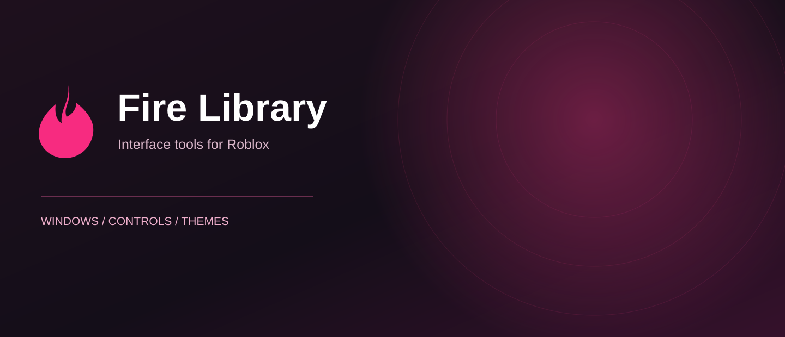

Windows, controls and themes with a compact Luau API. Create a window, add a tab, fill it with controls.

```lua
local window = Fire:Window({
    Text = "My Interface",
    Keybind = Enum.KeyCode.RightShift,
})

local main = window:AddTab("Main", { Text = "Main" })
local controls = main:AddLeftGroupbox("Controls", { Text = "Controls" })

controls:AddToggle("Enabled", {
    Text = "Enabled",
    Value = false,
    Callback = function(value)
        print("Enabled:", value)
    end,
})
```

<CardGroup cols={2}>
  <Card title="Installation" icon="download" href="/getting-started/installation">
    Load the library in your executor.
  </Card>

  <Card title="Quickstart" icon="bolt" href="/getting-started/quickstart">
    Your first window in under a minute.
  </Card>

  <Card title="Elements" icon="shapes" href="/guides/controls">
    Buttons, toggles, sliders, text boxes and more.
  </Card>

  <Card title="Themes and configs" icon="palette" href="/guides/themes-configs">
    Restyle the UI and save control state.
  </Card>
</CardGroup>

<Note>
Unofficial community docs for Fire Library v5.2.6.
</Note>
