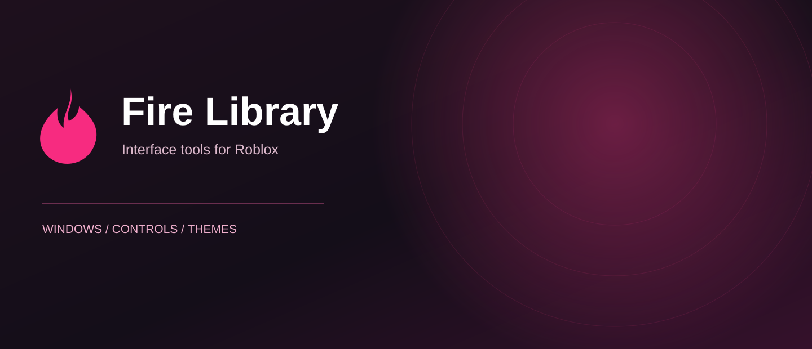

Окна, элементы управления и темы через компактный Luau API. Создай окно, добавь вкладку, заполни элементами.

```lua
local window = Fire:Window({
    Text = "My Interface",
    Keybind = Enum.KeyCode.RightShift,
})

local main = window:AddTab("Main", { Text = "Main" })
local controls = main:AddLeftGroupbox("Controls", { Text = "Controls" })

controls:AddToggle("Enabled", {
    Text = "Enabled",
    Value = false,
    Callback = function(value)
        print("Enabled:", value)
    end,
})
```

<CardGroup cols={2}>
  <Card title="Установка" icon="download" href="/ru/getting-started/installation">
    Загрузите библиотеку в executor.
  </Card>

  <Card title="Быстрый старт" icon="bolt" href="/ru/getting-started/quickstart">
    Первое окно меньше чем за минуту.
  </Card>

  <Card title="Элементы" icon="shapes" href="/ru/guides/controls">
    Кнопки, toggle, слайдеры, текстовые поля и другое.
  </Card>

  <Card title="Темы и конфиги" icon="palette" href="/ru/guides/themes-configs">
    Меняй стиль UI и сохраняй состояние элементов.
  </Card>
</CardGroup>

<Note>
  Неофициальная документация сообщества для Fire Library v5.2.6.
</Note>
